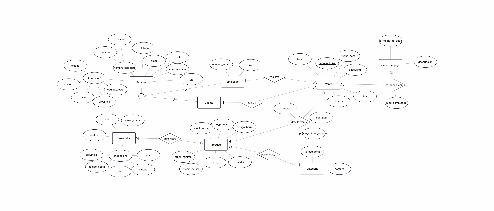
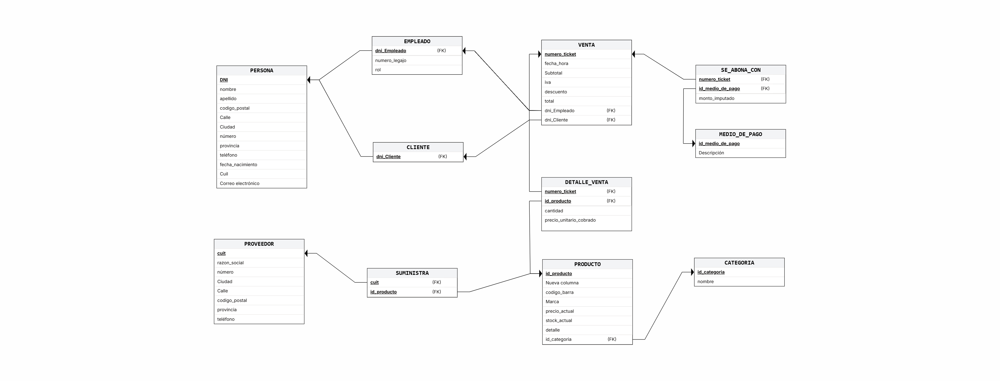

<div align="center">

<a href="https://git.io/typing-svg"></a>

# Supermercado "El Sol"
### Bases de Datos I (2026) · FaCENA, UNNE

<p>
  
  
  
  
  
</p>

</div>

---

## Descripción

Trabajo integrador de la cátedra Bases de Datos I (FaCENA - UNNE). Diseñamos, normalizamos en Tercera Forma Normal (3FN) e implementamos en SQL Server la base de datos para el Supermercado "El Sol", cubriendo el ciclo de ventas en línea de cajas, control de stock y abastecimiento de proveedores.

---

## Objetivos del sistema

<table align="center" width="100%">
  <tr>
    <td width="33%" valign="top">
      <h4>Línea de cajas</h4>
      <p>Registro de tickets con detalle de productos vendidos, cajero a cargo y fecha de la operación.</p>
    </td>
    <td width="33%" valign="top">
      <h4>Precios históricos</h4>
      <p>Guarda el precio cobrado en cada venta para no alterarlo si el precio del producto cambia después.</p>
    </td>
    <td width="33%" valign="top">
      <h4>Control de stock</h4>
      <p>Control de cantidades en depósito y alertas de stock mínimo para reponer góndolas a tiempo.</p>
    </td>
  </tr>
  <tr>
    <td width="33%" valign="top">
      <h4>Soporte multipago</h4>
      <p>Permite pagar un ticket combinando distintas formas de pago (efectivo, tarjetas, transferencias o QR).</p>
    </td>
    <td width="33%" valign="top">
      <h4>Clientes</h4>
      <p>Registro de clientes frecuentes para promociones y soporte de ventas a consumidor final.</p>
    </td>
    <td width="33%" valign="top">
      <h4>Proveedores</h4>
      <p>Gestión de proveedores comerciales y registro de los productos que suministra cada uno.</p>
    </td>
  </tr>
</table>

---

## Tablas del modelo

El esquema está normalizado en 3FN y organiza 11 tablas en tres áreas:

| Área | Tablas | Contenido |
|---|---|---|
| Personas y roles | PERSONA, CLIENTE, EMPLEADO | Datos personales compartidos y diferenciación entre clientes y empleados mediante el DNI. |
| Catálogo y stock | PRODUCTO, CATEGORIA, PROVEEDOR, SUMINISTRA | Clasificación por categorías, control de existencias y relación de suministro con proveedores. |
| Ventas y pagos | VENTA, DETALLE_VENTA, MEDIO_DE_PAGO, SE_ABONA_CON | Encabezado del ticket, detalle de artículos cobrados y medios de pago utilizados. |

---

## Estructura del repositorio

```text
proyecto-bd1-equipo-46/
├── docs/
│   ├── etapa-01/          Requerimientos y dominio del negocio
│   ├── etapa-02/          DER, modelo relacional y normalización
│   ├── etapa-03/          Implementación física y validaciones
│   ├── etapa-04/          Consultas del negocio y casos de uso
│   └── etapa-05/          Temas técnicos y optimización
├── sql/
│   ├── ddl/               Definición de estructuras y restricciones
│   ├── dml/               Carga y poblado de datos de prueba
│   ├── consultas/         Scripts de consultas y reportes
│   └── tecnico/           Procedimientos, funciones y triggers
└── README.md
```

---

## Avance del proyecto

| Etapa | Contenido | Estado |
| :---: | :---| :---: |
| 01 | Requerimientos y dominio del negocio |  |
| 02 | Modelo conceptual, relacional y normalización (3FN) |  |
| 03 | Implementación de la base de datos (DDL y DML) |  |
| 04 | Consultas del negocio y casos de uso |  |
| 05 | Temas técnicos (procedimientos, triggers, seguridad) |  |

---

## Documentación

<details>
<summary>Etapa 01: Requerimientos y dominio del negocio</summary>
<br>

- [Descripción del caso de estudio](docs/etapa-01/descripcion-caso-estudio.md)
- [Alcance del sistema](docs/etapa-01/alcance-sistema.md)
- [Reglas de negocio](docs/etapa-01/reglas-de-negocio.md)

</details>

<details>
<summary>Etapa 02: Modelado conceptual y relacional</summary>
<br>

- [Diagrama Entidad-Relación (DER)](docs/etapa-02/der/SupermercadoElSol-DER-final.png)
- [Componentes del modelo conceptual](docs/etapa-02/der/componentes-del-modelo-conceptual.md)
- [Decisiones de diseño del DER](docs/etapa-02/der/decisiones-diseno-der.md)
- [Decisiones de diseño del Modelo Relacional](docs/etapa-02/decisiones-modelo-relacional.md)
- [Diagrama del Modelo Relacional](docs/etapa-02/SupermercadoElSol-modelo-relacional(corregido).png)
- [Proceso de normalización en 3FN](docs/etapa-02/normalizacion.md)

</details>

<details>
<summary>Etapa 03: Implementación física (Scripts SQL)</summary>
<br>

Documentación técnica:
- [Implementación de la base de datos](docs/etapa-03/implementacion.md)
- [Restricciones de integridad](docs/etapa-03/restricciones-integridad.md)
- [Pruebas de validación](docs/etapa-03/pruebas-validacion.md)

Scripts SQL:
- [Script DDL (crear_bd.sql)](sql/ddl/crear_bd.sql)
- [Script DML (datos_prueba.sql)](sql/dml/datos_prueba.sql)

</details>

<details>
<summary>Etapa 04: Consultas del negocio y casos de uso</summary>
<br>

Documentación de consultas:
- [Casos de uso del sistema](docs/etapa-04/casos-uso.md)
- [Consulta 1: Comprobante de venta (Factura)](docs/etapa-04/comprobante-venta.md)
- [Consulta 2a: Ventas por vendedor](docs/etapa-04/consulta-02a-ventas-por-vendedor.md)
- [Consulta 2b: Ventas por categoría](docs/etapa-04/Consulta_Ventas_Por_Categoria.md)
- [Consulta 3a: Clientes con compras superiores a $5000 (HAVING)](docs/etapa-04/consulta-avanzada.md)
- [Consulta 3b: Ventas superiores al promedio (Subconsulta)](docs/etapa-04/consulta-03b-subconsulta.md)

Scripts SQL:
- [Consulta 1 (comprobante_venta.sql)](sql/consultas/comprobante_venta.sql)
- [Consulta 2a (02a_ventas_por_vendedor.sql)](sql/consultas/02a_ventas_por_vendedor.sql)
- [Consulta 2b (consulta_ventas_por_categoria.sql)](sql/consultas/consulta_ventas_por_categoria.sql)
- [Consulta 3a (03a_clientes_compras_mayores_5000.sql)](sql/consultas/03a_clientes_compras_mayores_5000.sql)
- [Consulta 3b (03b_consulta_avanzada_subconsulta.sql)](sql/consultas/03b_consulta_avanzada_subconsulta.sql)

</details>

---

## Diagramas

### Diagrama Entidad-Relación (DER)
<p align="center">
  
</p>

### Diagrama del Modelo Relacional
<p align="center">
  
</p>

---

## Integrantes (Equipo 46)

<table align="center">
  <tr>
    <td align="center" width="20%">
      <a href="https://github.com/soysid">
        <br>
        <sub>Alfredo Gabriel López</sub>
      </a>
    </td>
    <td align="center" width="20%">
      <a href="https://github.com/luzeli88">
        <br>
        <sub>Luz Espíndola</sub>
      </a>
    </td>
    <td align="center" width="20%">
      <a href="https://github.com/JorgeAleMaciel">
        <br>
        <sub>Jorge Alejandro Maciel</sub>
      </a>
    </td>
    <td align="center" width="20%">
      <a href="https://github.com/Vega-Jose-Maria">
        <br>
        <sub>José María Vega</sub>
      </a>
    </td>
    <td align="center" width="20%">
      <a href="https://github.com/vnahuel454">
        <br>
        <sub>Facundo Nahuel Villagra</sub>
      </a>
    </td>
  </tr>
</table>
