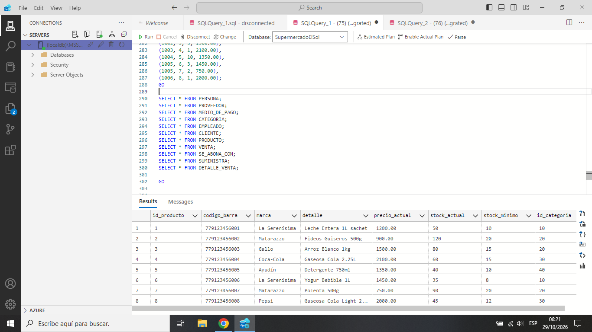
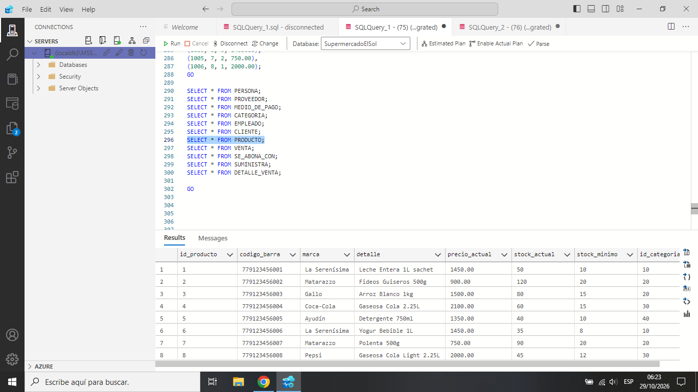
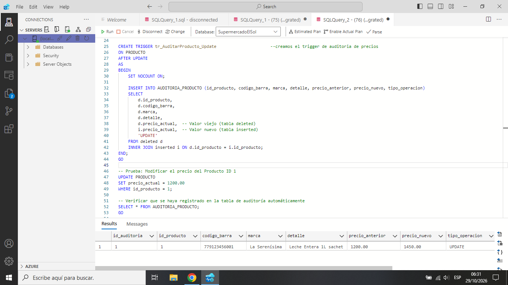

# Triggers de Auditoria para Modificación de Precios:

## 1. Definición y Objetivo
Un trigger de tipo `AFTER UPDATE` es un bloque de código transaccional que el motor de SQL Server ejecuta de forma automática e inmediata después de que se consolida una modificación en las filas de la tabla objetivo. Nuestro objetivo en **Supermercado El Sol** es interceptar cualquier cambio de precios en la tabla `PRODUCTO` antes de que se sobrescriba y se pierda el valor histórico.

## 2. Ventajas y Aplicaciones en el Negocio
* **Trazabilidad total:** Permite conocer el historial de variaciones de costos de la mercadería de forma transparente.
* **Auditoría de seguridad:** Al registrar la función `SYSTEM_USER`, el sistema del supermercado delata de forma inequívoca qué cuenta realizó la modificación en el SGBD.

## 3. Caso de Aplicación Concreto (Tablas Inserted y Deleted)
Cuando ocurre el `UPDATE`, el motor expone dos estructuras lógicas en memoria:
* **`deleted`:** Mantiene los valores de los registros tal como estaban antes de la consulta (guarda el precio anterior).
* **`inserted`:** Contiene las filas con las modificaciones ya aplicadas (guarda el nuevo precio).

El trigger realiza un `JOIN` entre ambas estructuras usando el campo `id_producto` para insertar de manera limpia ambos estados en nuestra tabla `AUDITORIA_PRODUCTO`.

## 4. Demostración y Evidencias de Funcionamiento

### Paso A: Estado inicial de las tablas
Antes de la prueba, verificamos el precio vigente del producto y confirmamos que la tabla de auditoría se encuentra totalmente vacía.

### Paso B: Ejecución del cambio de precio (UPDATE)
Se procede a actualizar el valor de la columna `precio_actual` simulando una actualización de precios en el sistema.

### Paso C: Verificación del cambio automatico por parte del Trigger
Consultamos la tabla `AUDITORIA_PRODUCTO`. Se observa que el trigger capturó los estados en memoria y guardó el registro histórico con el sello de tiempo y el usuario.

